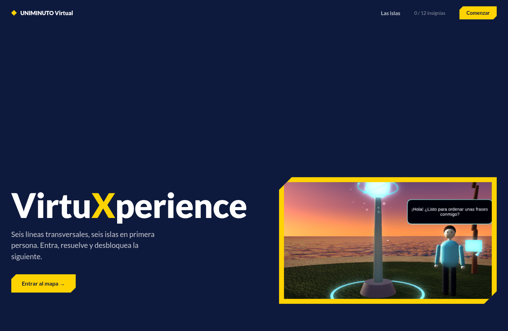
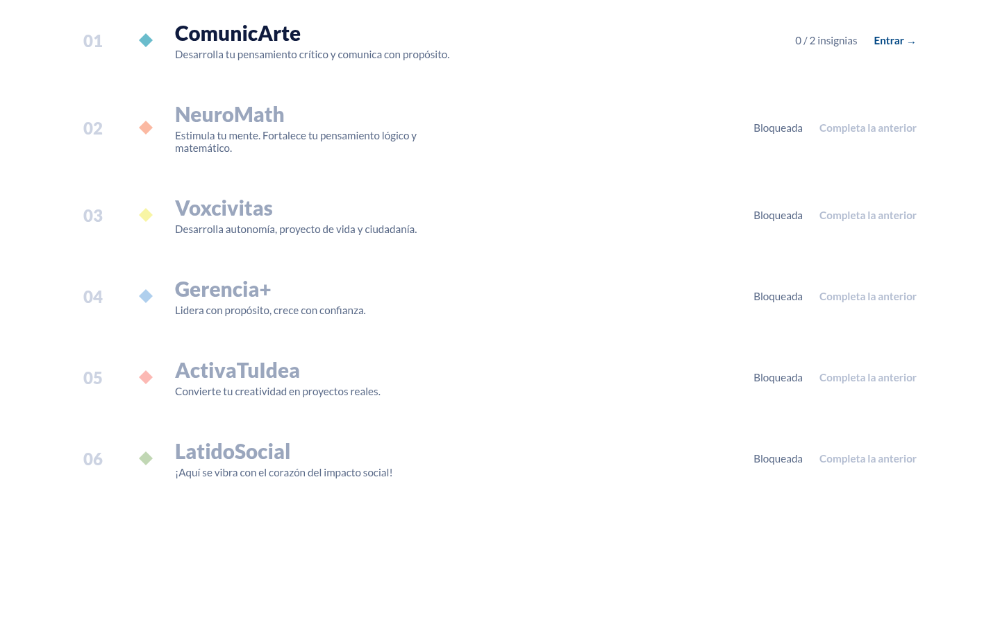
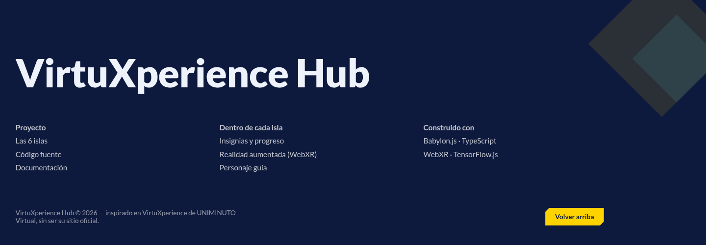
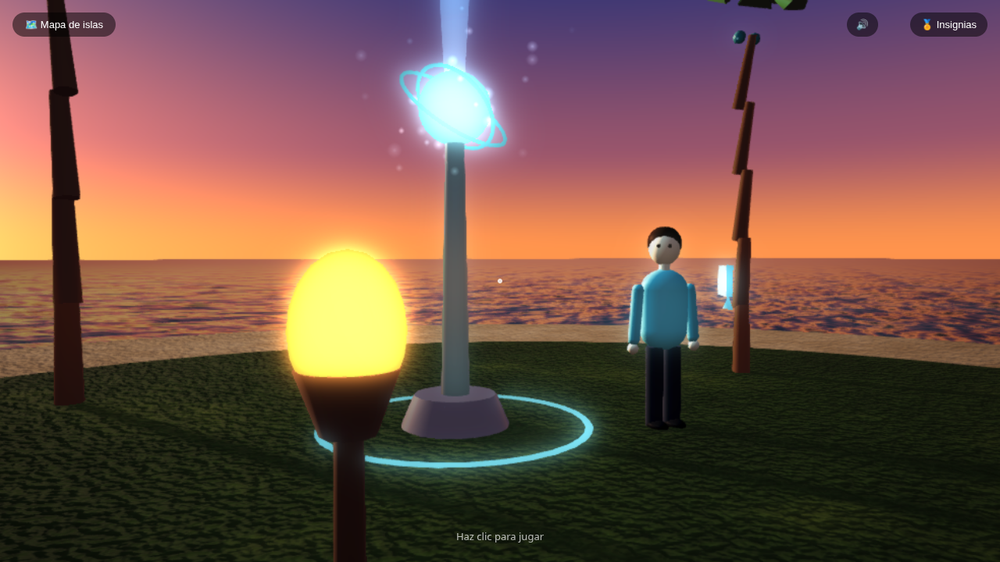
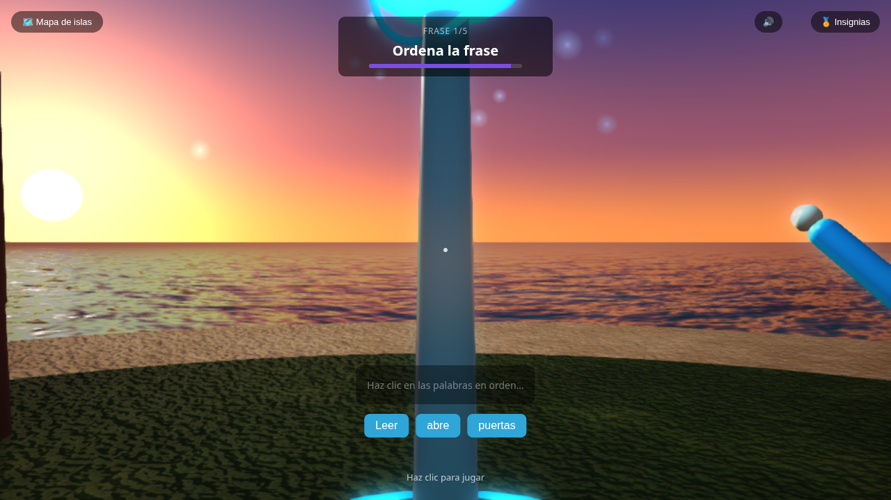
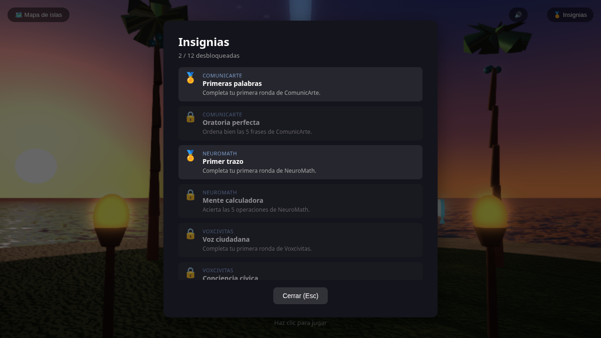

# VirtuXperience Hub — Prueba Técnica

> Ecosistema virtual inmersivo (WebXR/3D) para UNIMINUTO Virtual: una landing page institucional con un **mapa de islas** tipo videojuego — una por línea transversal — que se desbloquean en orden a medida que se completan insignias. Cada isla desbloqueada se abre como su propio **mundo 3D en primera persona** con tecnología WebXR y su minijuego educativo.

**Demo en vivo:** **<https://virtuxperience-hub.vercel.app>** — se abre directo en el navegador (PC o celular), sin instalar nada. También se puede ejecutar en local siguiendo la sección [Instalación y ejecución](#instalación-y-ejecución). El proyecto no requiere backend ni cuenta externa.

---

## Tabla de contenido

- [Descripción del proyecto](#descripción-del-proyecto)
- [Tecnologías y herramientas utilizadas](#tecnologías-y-herramientas-utilizadas)
- [Requisitos técnicos](#requisitos-técnicos)
- [Instalación y ejecución](#instalación-y-ejecución)
- [Estructura del proyecto](#estructura-del-proyecto)
- [Arquitectura de la solución](#arquitectura-de-la-solución)
- [Funcionalidades desarrolladas](#funcionalidades-desarrolladas)
- [Controles](#controles)
- [Evidencias de la solución](#evidencias-de-la-solución)
- [Decisiones técnicas y alcance](#decisiones-técnicas-y-alcance)
- [Información para la evaluación](#información-para-la-evaluación)

---

## Descripción del proyecto

**VirtuXperience Hub** es la implementación técnica de la iniciativa VirtuXperience de UNIMINUTO Virtual (ver contexto pedagógico completo en [`docs/CONTEXTO-PEDAGOGICO.md`](docs/CONTEXTO-PEDAGOGICO.md)).

**Flujo de la aplicación:**

1. El usuario llega a una **landing page** (`src/landing/LandingPage.ts`) con un hero y un índice de las 6 líneas transversales, cada una funcionando como entrada a su isla: bloqueada hasta que se completa la anterior.
2. Solo la primera isla empieza desbloqueada. Completar la insignia de "primera ronda" de una isla desbloquea la siguiente — así se fuerza un recorrido en orden por las 6 líneas transversales.
3. Al hacer clic en una isla desbloqueada, la aplicación construye **un mundo 3D en primera persona independiente para esa isla** (césped, playa, océano animado, portal y personaje guía) con tecnología WebXR, donde el jugador camina hasta el portal y resuelve el **minijuego educativo** de esa línea.
4. Un botón "🗺️ Mapa de islas" (o la tecla `Esc`) devuelve en cualquier momento a la landing page, que refleja el progreso actualizado.

El proyecto también incluye una capa experimental de **realidad aumentada vía WebXR** (`immersive-ar`) para dispositivos con soporte ARCore/ARKit, que permite colocar la isla activa sobre una superficie real detectada por la cámara del celular.

---

## Tecnologías y herramientas utilizadas

| Categoría | Herramienta | Uso en el proyecto |
| --- | --- | --- |
| Lenguaje | TypeScript 5 (`strict` mode) | Todo el código fuente |
| Motor 3D | [Babylon.js](https://www.babylonjs.com/) 8 (`core`, `gui`, `loaders`, `materials`) | Escena 3D, cámara, colisiones, materiales PBR, sombras con PCF, `ReflectionProbe` para luz ambiente, tone mapping ACES + viñeta + FXAA, `GlowLayer`, sistemas de partículas |
| Audio | Web Audio API | Ambiente, pasos y efectos sintetizados por código (sin archivos de sonido) |
| Gráficos procedurales | Canvas 2D + GLSL propio | Texturas de césped/adoquín/piedra con mapas de normales y shader de cielo de atardecer (sin imágenes externas) |
| Machine Learning en navegador | [TensorFlow.js](https://www.tensorflow.org/js) 4 | Red neuronal entrenada en el propio cliente para reconocer dígitos dibujados a mano (minijuego NeuroMath) |
| Build tool / dev server | [Vite](https://vitejs.dev/) 6 | Bundling, HMR, servidor de desarrollo |
| HTTPS local | `@vitejs/plugin-basic-ssl` | Certificado autofirmado para servir por HTTPS, requisito de WebXR/`getUserMedia` como *secure context* |
| Realidad aumentada | WebXR Device API (`immersive-ar`, `hit-test`, `dom-overlay`) | Sesión de RA opcional en dispositivos compatibles |
| Persistencia | `localStorage` del navegador | Sistema de insignias (logros desbloqueados por el usuario) |
| Testing manual | [Playwright](https://playwright.dev/) (herramienta de apoyo, no es dependencia de producción) | Verificación automatizada end-to-end durante el desarrollo (capturas de pantalla, chequeo de consola sin errores) |

No hay backend, base de datos ni servicios externos: la aplicación es 100% estática y corre por completo en el navegador del usuario. Tampoco incluye imágenes, modelos 3D ni audio: texturas, cielo y sonido se generan por código al iniciar.

---

## Requisitos técnicos

- **Node.js** 18 o superior (recomendado 20+).
- **npm** 9 o superior.
- Navegador moderno con soporte WebGL2: Chrome, Edge o Firefox actualizados.
- Para probar la realidad aumentada (opcional, no bloquea el resto de la app): un dispositivo Android con ARCore certificado y Chrome actualizado.

---

## Instalación y ejecución

```bash
# 1. Clonar el repositorio
git clone <URL-del-repositorio>
cd Proyecto-inmersivo

# 2. Instalar dependencias
npm install

# 3. Levantar el servidor de desarrollo (HTTPS autofirmado)
npm run dev
```

Esto expone la aplicación en:

- `https://localhost:5173/` — para probar desde el mismo equipo.
- `https://<IP-de-tu-red-local>:5173/` — para probar desde un celular conectado a la misma red Wi-Fi (necesario para probar la cámara/RA).

> El primer acceso mostrará una advertencia de "certificado no confiable" porque el HTTPS es autofirmado (necesario para que el navegador habilite `navigator.xr` y `getUserMedia`). Es seguro continuar ("Avanzado" → "Continuar de todos modos").

**Otros scripts disponibles:**

```bash
npm run build     # Compila TypeScript y genera el bundle de producción en dist/
npm run preview   # Sirve el build de producción localmente para verificarlo
```

No se requiere ninguna variable de entorno ni archivo `.env`: el proyecto no consume APIs externas.

### Despliegue (Vercel)

La versión pública vive en <https://virtuxperience-hub.vercel.app>. Al ser un sitio 100% estático, Vercel solo ejecuta `npm run build` y sirve `dist/` (configurado en [`vercel.json`](vercel.json)). Vercel entrega HTTPS con un certificado válido, así que desde el link público la cámara y la RA funcionan sin la advertencia de "certificado no confiable" del servidor local.

El repositorio está conectado a Vercel: cada push a `master` publica una nueva versión automáticamente. Para desplegar a mano desde la terminal:

```bash
npx vercel login          # una sola vez
npx vercel deploy --prod
```

---

## Estructura del proyecto

```text
Proyecto-inmersivo/
├── index.html                  # Punto de entrada HTML (canvas + contenedor de UI)
├── vite.config.ts              # Configuración de Vite + plugin de HTTPS local
├── vercel.json                 # Configuración de despliegue en Vercel (build + caché de assets)
├── tsconfig.json               # Configuración de TypeScript en modo estricto
├── docs/
│   ├── CONTEXTO-PEDAGOGICO.md  # Descripción pedagógica/estratégica de VirtuXperience
│   └── evidencias/             # Capturas de pantalla de la solución funcionando
└── src/
    ├── main.ts                 # Bootstrap: ciclo de vida landing ↔ isla, HUD, zonas y XR
    ├── style.css                # Estilos globales: landing page, mapa de islas y UI de los minijuegos
    ├── vite-env.d.ts            # Tipos de Vite (import.meta.env)
    ├── landing/
    │   └── LandingPage.ts       # Hero institucional + mapa de islas (candados, progreso, clic para entrar)
    ├── core/
    │   └── Game.ts              # Motor Babylon.js: un único Engine persistente + Scene recreable por isla
    ├── scene/
    │   ├── Island.ts             # Construye el mundo de una isla: césped, playa, océano animado y muro
    │   ├── Environment.ts        # Luces, sombras, reflejos del cielo, niebla, glow, tone mapping y viñeta
    │   ├── Sky.ts                # Shader de cielo de atardecer (gradiente, sol, estrellas)
    │   ├── Scenery.ts            # Bosque, farolas, bancas, colinas lejanas y luciérnagas (instanciados)
    │   ├── ProceduralTextures.ts # Texturas y mapas de normales generados con Canvas 2D (césped/arena/agua/piedra)
    │   ├── PlayerController.ts   # Movimiento WASD + mouse look, pasos y balanceo de cabeza
    │   ├── ZoneManager.ts        # Detección de proximidad del jugador al portal de la isla
    │   ├── ZonePortal.ts         # Portal luminoso de la isla (baliza, aros, chispas)
    │   ├── Character.ts          # Personaje humanoide: mira al jugador, saluda y habla
    │   └── zones.config.ts       # Definición declarativa de las 6 líneas (orden, color, minijuego, saludo, insignia)
    ├── minigames/                # Un subdirectorio por línea transversal (ver detalle abajo)
    │   ├── neuromath/
    │   ├── comunicarte/
    │   ├── voxcivitas/
    │   ├── gerencia/
    │   ├── activatuidea/
    │   └── latidosocial/
    ├── systems/
    │   ├── AudioSystem.ts        # Audio procedural (Web Audio): ambiente, pasos, proximidad y efectos
    │   ├── BadgeSystem.ts        # Insignias de logro persistidas en localStorage
    │   └── NarrativeSystem.ts    # Punto de extensión para eventos narrativos
    ├── ui/                       # HUD y paneles HTML/CSS de cada minijuego
    ├── xr/
    │   └── setupXR.ts            # Sesión WebXR immersive-ar, hit-test y colocación por RA
    └── types/
        └── zone.ts               # Contratos TypeScript compartidos (ZoneDefinition, contexto de entrada)
```

Cada minijuego sigue el mismo patrón de dos archivos:

- `register<Nombre>.ts`: registra el *handler* del minijuego contra su zona en `zones.config.ts`.
- `<Nombre>Game.ts`: la lógica del minijuego (preguntas, puntaje, tiempo, integración con su HUD).

---

## Arquitectura de la solución

```text
                 ┌───────────────────────────┐
                 │          main.ts           │  bootstrap: arranca en la landing
                 └──────────────┬──────────────┘
                                │
                 ┌──────────────▼──────────────┐
                 │   landing/LandingPage.ts     │  hero + mapa de islas
                 │  (lee BadgeSystem → candados)│
                 └──────────────┬──────────────┘
                                │ clic en isla desbloqueada
                                ▼
                 ┌──────────────────────────────┐
                 │   core/Game (Engine único)    │  game.resetScene() por cada
                 │   + scene/Island.ts           │  entrada/salida de isla
                 │   + PlayerController + XR     │
                 └──────────────┬───────────────┘
                                │ proximidad + tecla E
                                ▼
                    ┌───────────────────────┐
                    │  zones.config.ts       │  6 ZoneDefinition en orden
                    │  (color, minigameId,   │
                    │  firstRoundBadgeId)    │
                    └───────────┬───────────┘
                                ▼
                 ┌─────────────────────────┐
                 │ minigames/<zona>Game.ts  │  lógica + puntaje
                 └────────────┬────────────┘
                                ▼
                 ┌─────────────────────────┐
                 │  ui/<Zona>HUD.ts         │  overlay HTML/CSS
                 └────────────┬────────────┘
                                ▼
                 ┌─────────────────────────┐
                 │ systems/BadgeSystem      │  localStorage → desbloquea
                 └─────────────────────────┘     la siguiente isla
```

**Principios de diseño:**

- **Un Engine, muchas escenas**: el contexto WebGL (`Engine`) se crea una sola vez y se reutiliza durante toda la sesión; cada entrada a una isla llama a `Game.resetScene()`, que descarta por completo la escena anterior (geometría, materiales, texturas, luces, partículas) y crea una nueva vacía. Recrear el `Engine` en cada visita (en vez de la `Scene`) se probó primero y resultó frágil: el navegador libera el contexto WebGL de forma asíncrona y compite con la creación del siguiente. Ver [`core/Game.ts`](src/core/Game.ts).
- **Islas desacopladas entre sí**: `scene/Island.ts` construye un mundo completo y autocontenido (terreno, océano, portal, personaje) a partir de una sola `ZoneDefinition`; no sabe nada de las otras 5 islas ni de la landing page.
- **Progresión declarativa**: cada `ZoneDefinition` en `zones.config.ts` lleva su `firstRoundBadgeId`; `LandingPage.isIslandUnlocked(index)` solo consulta si la insignia de la isla anterior ya está en `BadgeSystem`. Añadir una isla nueva es añadir una entrada a ese arreglo.
- **Minijuegos desacoplados de la escena**: dentro de una isla, no hay recarga de página ni cambio de escena al entrar a su minijuego. `ZoneManager` congela el movimiento del jugador (`freezeMovement`) y el minijuego monta su propio overlay HTML sobre `ui-root`, con un `onExit` para devolver el control a la isla.
- **UI como overlay HTML, no como GUI 3D**: tanto la landing page como cada minijuego (`ui/*HUD.ts`) son capas DOM independientes del canvas de Babylon.js, lo que permite estilos CSS normales, mejor accesibilidad y reutilización del mismo patrón.
- **Compatibilidad dual escritorio/XR**: `ZoneManager.update()` recibe la posición del jugador desde `PlayerController` (modo escritorio, WASD + pointer lock) o desde la cámara WebXR (`arCamera.globalPosition`, modo RA), sin duplicar la lógica de detección de zonas.
- **ML embebido sin backend**: el reconocimiento de escritura de NeuroMath entrena un modelo pequeño con TensorFlow.js directamente en el navegador al cargar la app (`digitModel.ts`), sin llamadas a un servicio externo de inferencia.

---

## Funcionalidades desarrolladas

### Landing page: un solo motivo, la paleta real de UNIMINUTO
Rediseñada alrededor de una sola idea geométrica: el aspa que forma la "X" de "VirtuXperience" es, en esencia, un cuadrado girado 45° — un chaflán. Ese único corte gobierna toda la página (la tarima del hero, el marco de la captura real, los botones, las muescas de color del índice de islas y la marca grande del footer), sobre la paleta y tipografía reales de UNIMINUTO (azul marino, dorado, Lato):
- **Cabecera de una sola fila**: marca, enlace al índice y botón de CTA dorado — sin menús decorativos que no llevan a ningún sitio.
- **Hero**: wordmark "VirtuXperience" (la X en dorado) sobre fondo azul marino plano, junto a un panel achaflanado con una captura real de una isla del juego, revelada con una animación de obturador al cargar.
- **Índice de las 6 islas**: no es una grilla de tarjetas, es una lista tipográfica — numeral de orden, muesca de diamante con el color real de cada línea, nombre, descripción, progreso de insignias (`X / 2`) y "Entrar"/"Bloqueada". Clic en una fila bloqueada la hace vibrar en vez de entrar. La primera isla siempre está desbloqueada; cada siguiente se desbloquea al completar la insignia de "primera ronda" de la anterior.
- El contador de insignias de la cabecera y el estado de cada fila se recalculan cada vez que se vuelve a la landing page (p. ej. justo después de ganar una insignia).
- **Footer**: la marca "VirtuXperience Hub" construida grande sobre el motivo de diamantes, con columnas de enlaces reales del proyecto en vez de certificaciones institucionales que no aplican.
- **Revelado al hacer scroll**: cada sección aparece con una leve transición al entrar en la vista; sin movimiento para quien pide `prefers-reduced-motion`.

**Dos cosas de la página real de UNIMINUTO no se reproducen, a propósito:**
- La fotografía de la estudiante del hero es de una persona real → en su lugar, el hero usa una captura real del propio juego.
- El footer institucional (certificaciones ISO/IQNET, logos de organizaciones aliadas, direcciones y avisos legales de UNIMINUTO) no se reproduce con esos datos, porque no son de este proyecto → se mantiene el mismo lenguaje visual (la marca construida grande), con contenido real de este proyecto.

### Cada isla: un mundo 3D independiente
- Al entrar a una isla desbloqueada, la aplicación construye su propio mundo en primera persona (WASD + mouse look con pointer lock): un islote con césped al centro, playa de arena alrededor y océano animado hasta el horizonte, con un muro invisible que mantiene al jugador en tierra.
- El portal de la isla es una baliza con haz de luz, aros giratorios y chispas, en el color de su línea transversal, con un personaje guía al lado.
- Decoración temática: palmeras y antorchas tiki con llama animada.
- Detección de proximidad con aviso en pantalla ("Presiona E para entrar") y entrada por tecla `E`; un botón "🗺️ Mapa de islas" (o la tecla `Esc`) devuelve a la landing page en cualquier momento.

### Realismo visual
- **Materiales PBR** con texturas y mapas de normales procedurales (césped, arena, agua, adoquín/piedra del zócalo del portal) en vez de colores planos.
- **Océano animado**: un mapa de normales de oleaje se desplaza por UV cada frame, dando sensación de agua en movimiento sin geometría que se mueva.
- **Iluminación coherente con el cielo**: el sol del shader de atardecer y la luz direccional apuntan al mismo lado; el cielo se captura en un `ReflectionProbe` que aporta luz ambiente y reflejos (visibles en el océano) a los materiales PBR.
- **Sombras** dinámicas (PCF) de palmeras, antorchas, portal y personaje.
- **Perspectiva atmosférica**: niebla exponencial del color del horizonte.
- **Post-proceso**: tone mapping ACES, viñeta y FXAA vía `scene.imageProcessingConfiguration` + `FxaaPostProcess`.
- **Vida ambiental**: antorchas con llama animada y balizas con `GlowLayer`.
- **Personaje humanoide** (piernas, torso, brazos, cabeza, ojos y cabello) que respira, gira el cuerpo y la cabeza hacia el jugador, saluda al acercarse y muestra un globo de diálogo propio de su línea transversal.

### Inmersión
- **Sonido procedural** (Web Audio, sin archivos): viento, grillos y un colchón grave de fondo; pasos distintos sobre piedra y pasto; un zumbido que se intensifica al acercarse a un portal (cada zona tiene su nota); y efectos para entrar/salir de una zona, acierto, error e insignia. Se silencia con `M` o con el botón 🔊 (la preferencia se guarda).
- **Andar con peso**: cada paso suena y produce un leve cabeceo y balanceo de la cámara.
- **Transición al cruzar un portal**: destello del color de la zona y un breve "tirón" del campo de visión.
- **Aviso al desbloquear una insignia**, con sonido, sin tener que abrir el panel.

### Los 6 minijuegos

| Zona | Minijuego | Mecánica |
| --- | --- | --- |
| **ComunicArte** | Ordena la frase | El jugador reconstruye 5 frases haciendo clic en las palabras en el orden correcto, contrarreloj. |
| **NeuroMath** | Dibuja la respuesta | El jugador resuelve 5 operaciones matemáticas **dibujando el dígito de la respuesta a mano** sobre un canvas; un modelo de TensorFlow.js entrenado en el navegador reconoce el número dibujado. |
| **Voxcivitas** | Dilemas ciudadanos | 5 dilemas de convivencia y ciudadanía con dos opciones cada uno; el jugador elige y recibe retroalimentación justificando la respuesta correcta. |
| **Gerencia+** | Reparto de recursos | El jugador distribuye un presupuesto limitado (horas, dinero, etc.) entre iniciativas con distinto valor y tope, maximizando el resultado del escenario. |
| **ActivaTuIdea** | Reto de innovación | Ante un problema real del campus, el jugador elige entre 4 posibles soluciones cuál ataca la causa raíz del problema. |
| **LatidoSocial** | Emparejar necesidad-acción | El jugador conecta una necesidad social con la acción comunitaria que mejor la resuelve. |

Todos los minijuegos comparten: barra de progreso por pregunta, temporizador, pantalla de resultados al finalizar y desbloqueo de una **insignia** (`BadgeSystem`) persistida en `localStorage` la primera vez que se completan.

### Panel de insignias
- Botón "🏅 Insignias" visible en la esquina superior derecha dentro de cualquier isla (clic o tecla `B`) que abre un panel con el catálogo completo de 12 insignias (dos por línea transversal: primera ronda completada y ronda perfecta).
- Cada insignia muestra su estado — desbloqueada (🏅) o bloqueada (🔒) — junto a su nombre y descripción, con un contador de progreso (`X / 12 desbloqueadas`).
- El estado se lee directamente de `localStorage`, por lo que persiste entre sesiones del navegador.

### Realidad aumentada (WebXR, experimental)
- Botón de entrada a sesión `immersive-ar` cuando el navegador/dispositivo lo soporta, disponible dentro de cada isla.
- `hit-test` contra superficies reales para colocar la isla activa sobre el suelo detectado por la cámara.
- `dom-overlay` para mostrar la UI encima del feed de la cámara durante la sesión de RA.
- Manejo de error visible en pantalla (`showXRError`) cuando el dispositivo no certifica ARCore/ARKit, en vez de fallar en silencio.

> **Nota de alcance:** esta función depende de que el hardware del dispositivo tenga ARCore/ARKit certificado. En equipos sin esa certificación (verificado incluso contra la [demo oficial de WebXR](https://immersive-web.github.io/webxr-samples/immersive-ar-session.html), que también falla en esos dispositivos), el navegador rechaza la sesión con `NotSupportedError`. Es una limitación de hardware, no del código. La app sigue siendo completamente funcional en modo escritorio/móvil sin RA.

---

## Controles

| Acción | Control |
| --- | --- |
| Entrar a una isla desbloqueada | Clic sobre ella en el mapa de islas |
| Moverse (dentro de una isla) | `W` `A` `S` `D` |
| Mirar alrededor | Mouse (clic sobre el canvas activa el *pointer lock*) |
| Entrar al minijuego del portal | `E` (estando dentro de su radio) |
| Responder / dibujar en un minijuego | Clic o touch, según el minijuego |
| Ver insignias obtenidas | `B` o clic en el botón "🏅 Insignias" |
| Silenciar / activar el sonido | `M` o clic en el botón 🔊 |
| Volver al mapa de islas | `Esc` o clic en "🗺️ Mapa de islas" |
| Entrar a RA (si el dispositivo lo soporta) | Botón de RA en pantalla |

---

## Evidencias de la solución

Capturas tomadas directamente sobre la aplicación corriendo en local (`docs/evidencias/`):

| Captura | Descripción |
| --- | --- |
|  | Cabecera de una fila y hero con el wordmark "VirtuXperience", sobre fondo azul marino plano, junto al panel achaflanado con la captura real de una isla. |
|  | Índice tipográfico de las 6 líneas: ComunicArte desbloqueada, el resto con "Bloqueada" hasta completar la anterior. |
|  | Footer con la marca "VirtuXperience Hub" construida grande sobre el motivo de diamantes, y columnas con contenido propio de este proyecto. |
|  | Isla de ComunicArte: portal, personaje guía, palmeras, antorcha y océano animado, al atardecer. |
|  | Minijuego de ComunicArte ("Ordena la frase") abierto sobre el fondo 3D de su isla. |
|  | Panel de insignias (2/12 desbloqueadas) abierto desde dentro de una isla. |

---

## Decisiones técnicas y alcance

- **Sin backend por diseño**: la prueba se centró en demostrar la experiencia inmersiva y la lógica de los minijuegos en el cliente. El `BadgeSystem` usa `localStorage` en vez de una base de datos porque no había un requisito de persistencia multiusuario/multisesión.
- **RA con cámara real limitada al hardware disponible**: se evaluó una alternativa de *passthrough* de cámara vía `getUserMedia` combinada con seguimiento de manos (TensorFlow.js `hand-pose-detection`) para permitir dibujar con la mano en NeuroMath usando la cámara del computador. Se implementó y se probó, pero el modelo de detección de manos devolvía resultados numéricamente inválidos (`NaN`) en el hardware de prueba disponible incluso tras varios intentos de corrección (backend CPU, ajustes de precisión de texturas WebGL). Ante esa inestabilidad, se decidió **revertir esa función** y mantener el dibujo por mouse/touch, que es estable y no depende de la cámara. El código de RA con `hit-test` (sección anterior) sí se mantiene porque no presentó ese problema y funciona en dispositivos con ARCore/ARKit certificado.
- **Cero assets externos**: las texturas se dibujan con Canvas 2D, el cielo es un shader y el audio se sintetiza con Web Audio. Así se conserva la ejecución 100 % estática y sin descargas; el costo es ~0,5 s extra de arranque para generar las texturas. Si más adelante se quiere un acabado fotográfico, basta con sustituir `ProceduralTextures.ts` por texturas/HDRI reales sin tocar el resto.
- **Sin pipeline de post-proceso dedicado (`DefaultRenderingPipeline`/bloom)**: se probó primero, pero al reconstruir la escena en cada entrada/salida de isla, su compilación interna de shaders (asíncrona) a veces competía con la de la isla siguiente. Se optó por tone mapping/viñeta directos en `scene.imageProcessingConfiguration` (sin pipeline propio) y un `FxaaPostProcess` suelto para el antialiasing: visualmente casi idéntico, sin esa fuente de inestabilidad. El brillo de balizas y antorchas lo sigue dando el `GlowLayer`, que no se vio afectado.
- **Realismo y RA**: el océano animado, el bosque de palmeras y el GlowLayer solo están activos en modo escritorio. En RA la isla se reduce ~25× para colocarse sobre una superficie real, así que esos elementos se apagan al entrar a la sesión (`Environment.setOutdoorEnabled`).
- **Sin rebote vertical real de la cámara**: la cámara usa gravedad y colisiones de Babylon, que corrigen cualquier cambio de altura; el balanceo al caminar se simula con cabeceos de pitch/roll aplicados de forma incremental (`PlayerController.updateWalk`).
- **Un Engine persistente, no uno por isla**: la primera versión creaba un `Engine` de Babylon.js nuevo en cada entrada/salida de isla; el navegador libera el contexto WebGL anterior de forma asíncrona, y crear uno nuevo en el mismo `<canvas>` demasiado rápido fallaba de forma intermitente. La solución final (`Game.resetScene()`) mantiene un único `Engine` durante toda la sesión y solo descarta/recrea la `Scene`, que es el patrón recomendado por Babylon.js para "recargar un nivel".
- **TypeScript en modo `strict`** con `noUnusedLocals`/`noUnusedParameters` activados, para mantener el código sin variables u parámetros muertos.

---

## Información para la evaluación

- **Probar sin instalar nada**: <https://virtuxperience-hub.vercel.app>.
- **Para ver todas las islas sin jugar cada una**: en la consola del navegador, `localStorage.setItem("virtuxperience:badges", JSON.stringify(["comunicarte-primera-ronda","neuromath-primera-ronda","voxcivitas-primera-ronda","gerencia-primera-ronda","activaidea-primera-ronda"]))` y recargar — desbloquea las 6 islas de una vez (los IDs exactos están en `BADGE_CATALOG`, [`src/systems/BadgeSystem.ts`](src/systems/BadgeSystem.ts)).
- **Punto de entrada para revisar código**: [`src/main.ts`](src/main.ts) orquesta el ciclo de vida landing ↔ isla; [`src/landing/LandingPage.ts`](src/landing/LandingPage.ts) es el mapa de islas y [`src/scene/Island.ts`](src/scene/Island.ts) el mundo 3D de cada una.
- **Para revisar un minijuego específico**: abrir `src/minigames/<zona>/` — cada uno es autocontenido y sigue el mismo contrato (`ZoneEnterContext`) definido en [`src/types/zone.ts`](src/types/zone.ts).
- **Verificación de tipos**: `npx tsc --noEmit` (sin errores).
- **Build de producción**: `npm run build` (genera `dist/` sin errores; advertencia de tamaño de chunk esperada por el peso de Babylon.js + TensorFlow.js, no es un error).
- **No se requieren credenciales, tokens ni cuentas de terceros** para instalar, ejecutar o evaluar el proyecto. 
